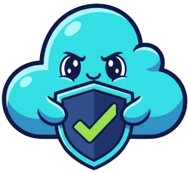
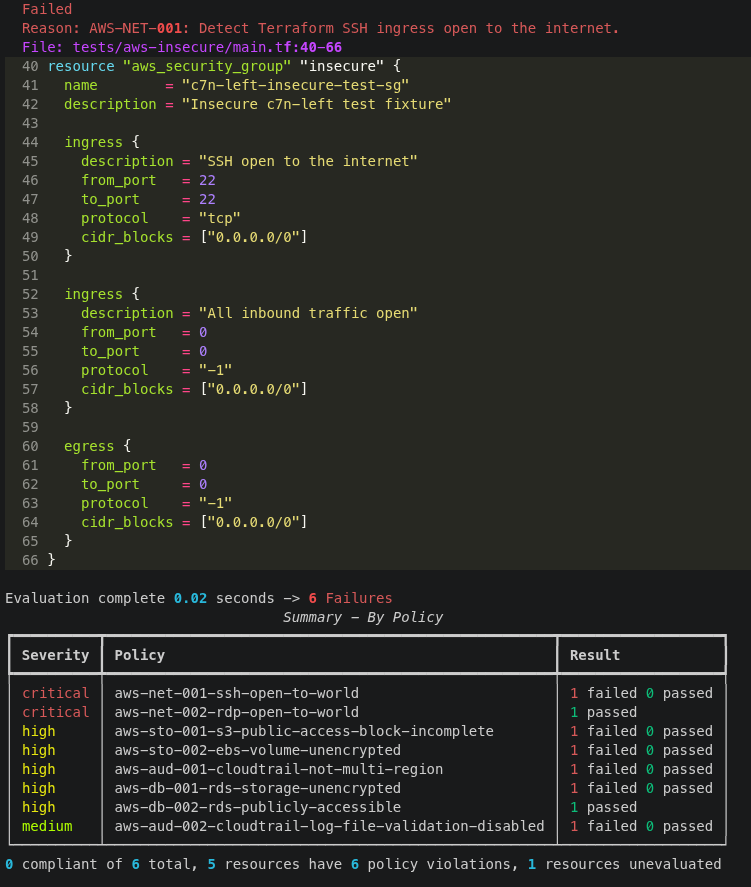
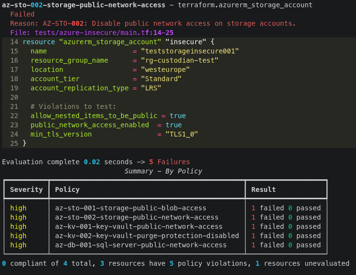

# Conform

  


   


**Check** and **Enforce** cloud security standards.  


## Abstract  
Conform is a cloud security policy collection built on [Cloud Custodian](https://github.com/cloud-custodian/cloud-custodian).  
It is designed for **cloud security teams** to operationalize security policies, validate compliance, and enforce organizational standards across cloud environments.  
Built on a policy-as-code approach, it turns security requirements into version-controlled, automated checks.  

Conform combines two complementary approaches:  

**Runtime assessment**: Detect security issues in deployed cloud environments.  
**Terraform scanning**: Catch insecure configurations before deployment.


## Use cases

Conform deliberately maintains an agnostic repository and policy structure to support integration across a broad range of use cases, including, but not limited to:  

- **Compliance checks:** Assess cloud resources against internal security baselines and compliance requirements.
- **Security standards enforcement:** Define consistent security rules and help teams maintain them across cloud providers.
- **CSPM and auditing:** Identify misconfigurations in deployed infrastructure and support recurring security audits.
- **Shift-left security:** Detect insecure Terraform configurations before deployment.
- **CI/CD integration:** Automate security checks in development workflows to catch violations early.
- **Remediation and continuous improvement:** Track policy violations, guide remediation, and verify that fixes meet security requirements.  

For a simple example on how to integrate it into a CI pipeline, take a look at [this](https://github.com/r3drun3/aws-terraform-insecure) repository.  

> [!TIP]
> Conform policies are primarily designed to support organization-specific compliance checks, which can vary depending  
> on the requirements security standards, and governance frameworks of each organization.  
> For Infrastructure as Code (IaC) pipelines, it is recommended to complement Conform  
> with additional configuration security scanning tools, such as [Trivy](https://trivy.dev/docs/latest/tutorials/misconfiguration/terraform/), to provide broader security coverage.  


## Usage  

Fork or clone this repository as a baseline for your organization, then customize and extend its policies to meet your organization's security standards, compliance requirements, and cloud governance needs.  

Use a dedicated Python virtual environment to isolate Cloud Custodian dependencies from the system Python installation.


```bash
# Create a virtual environment
python3 -m venv .venv

# Activate it (Linux/macOS)
source .venv/bin/activate

# Upgrade pip
python -m pip install --upgrade pip

# Install Cloud Custodian (AWS), Azure support, and Terraform IaC scanning
python -m pip install c7n c7n-azure c7n-left
```

Verify the installation:

```bash
python --version
python -m pip --version
custodian version
c7n-left --help
```

When working on the repository again, activate the environment before running the tools:

```bash
source .venv/bin/activate
```

To leave the virtual environment:

```bash
deactivate
```  

## Validate policies  

Validate all policies:  
```bash
find aws azure -type f -name '*.yml' -print0 |
xargs -0 -n1 custodian validate
```  

Validate single policy:  
```bash
custodian validate ./path/to/policy
```   

## Run against cloud tenants

aws example (set your preferred authentication method first):  
```bash
for policy in aws/runtime/*.yml; do
  name="$(basename "$policy" .yml)"
  custodian run \
    --region eu-north-1 \
    --output-dir "out/aws-runtime/$name" \
    "$policy" || exit 1
done
```  

azure example (set your preferred authentication method first):  
```bash
custodian run \
  --output-dir out/azure-runtime/storage-public-access \
  azure/runtime/storage-public-access.yml  
```  


## Run against terraform files  

aws test:   
```bash
c7n-left run \
  --policy-dir aws/terraform \
  --directory tests/aws-insecure
```  

output example:  
  


azure test:   
```bash
c7n-left run \
  --policy-dir azure/terraform \
  --directory tests/azure-insecure
```  

output example:  
  


